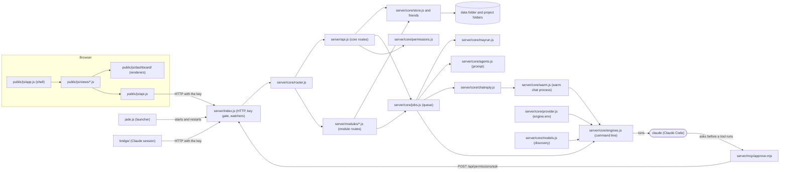

# Architecture

This is the map of Jade Base: which piece does what, which files own it, what other code may rely on, and which tests watch it.
It is written for a person who wants to change or repair something, and for the assistant helping them.

How to read it:

- Each area has **Files** (who owns it), **Interface** (the few functions or routes other code may call), **Invariants** (what must stay true) and **Tests**.
- It describes interfaces and rules, not how a function is built inside. How a function works inside can change; the interface and the invariants should not. Where this document and the code disagree, the code is right: fix the document.
- Files are named by path and function, never by line number.
- Where do I change X? See [where-to-change.md](architecture/where-to-change.md). What is in the data folder? See [data-folder.md](architecture/data-folder.md). What a word means: [GLOSSARY.md](../GLOSSARY.md). Why a decision was made: [docs/adr/](adr/).
- `node scripts/gates/docs.mjs` checks every path, npm script, route and setting named in these documents against the code.

## The map

## Words used here

Short versions; the full list is in [GLOSSARY.md](../GLOSSARY.md).

- **Data folder**: where Jade keeps its own files (`~/JadeBase`, or `JADE_HOME`). **State folder**: `.state/` inside it, for the key, caches and records Jade needs to run.
- **Project folder**: a folder on the PM's computer that a project points at. **Jade folder**: the `Jade/` sub-folder of a project's first folder, where Jade keeps that project's notes, actions, meetings and dashboards.
- **Run** or **job**: one piece of work done by Claude for Jade (a chat reply, a meeting, a dashboard, an agent). **Queue**: the list of jobs (`server/core/jobs.js`).
- **Agent**: a Claude Code agent file with a prompt and some Jade settings. **Skill**: a folder with a `SKILL.md`. **Module**: a switchable feature of Jade (a manifest file in `server/modules/`).
- **Key**: the secret that the browser and tools must show to talk to the server.
- **Gate**: a check script in `scripts/gates/` that is not a unit test.

## 1. How the app starts

**Files:** `jade.js` (launcher), `server/index.js` (server), `server/core/auth.js` (key), `server/core/opener.js`, `server/core/browser.js` (finds a browser, builds the app-window command), `server/core/gatepage.js`, `scripts/jade`, `scripts/jade.cmd`.

**What happens.** `npm start` runs `jade.js`. On a Node older than the minimum in `package.json` (`engines`) it prints a warning and carries on (`server/core/nodeversion.js`; test `test/node-version.test.js`); below Node 20 it stops. It refuses to start if another launcher owns the same data folder, writes its process id to `.state/jade.pid`, then forks `server/index.js` and watches the server's own code. When a file in `server/`, `server/core/` or `server/modules/` (or a user module) really changes, it restarts the server, but waits until no run is going (the server reports the number of running jobs to it). A crash restarts the server up to five times in a row. `server/index.js` loads settings, starts the store and queue, imports `server/api.js`, starts the modules (`modules.init`), then listens on `127.0.0.1` only. The first request is answered at once: the memory index is built in the background (about 200 ms after the start, in short slices), and the folder watches are put in place in short turns, so a big project folder does not delay the first page. See [PERFORMANCE.md](PERFORMANCE.md). It prints the start link once, to a terminal only, never to a log.

**The key gate.** `auth.token()` makes the key once and keeps it in `.state/token`. The start link `http://127.0.0.1:<port>/?key=<key>` sets a cookie and answers with a tiny script-free page that moves on to `/` (a redirect would lose the cookie when the link is opened from a local file). Who gets the page, and what the key does and does not protect, is in [SECURITY.md](SECURITY.md) and `docs/adr/0005-server-key-and-start-link.md`. The plain page for anyone without the key is `gatepage.js`; `opener.js` lets a launcher open the link without the key being on a command line; `node jade.js --open` (used by `scripts/jade` and `scripts/jade.cmd`) does only that, and starts no server.

**Interface:** `auth.token()`, `auth.okRead(req)`, `auth.okWrite(req)`, `auth.keyOk(text)`, `auth.startLink(port)`, `config.port()`.

**Invariants:**
- The server listens on `127.0.0.1` only and answers a request only if its `Host` is localhost (421 otherwise).
- The key is never in a Claude process's environment, a log, a command line or an API answer.
- Only one launcher per data folder; a second does not take over the first's process id file.
- Only a real change to a file's contents restarts the server or reloads a page (reading a file must not count: on Windows a read changes the access time).
- **The default port** is `DEFAULT_PORT` in `server/core/config.js` (this is the one place that names it; other documents link here). Four files keep a copy because they cannot import it (`bridge/jade-bridge.mjs`, `server/mcp/approve.mjs`, `scripts/jade`, `scripts/jade.cmd`); a test fails if one differs.

**Tests:** `test/key-gate.test.js`, `test/server-edges.test.js` (second launcher, port copies, last-resort handler), `test/core.test.js` (watchers), `scripts/gates/boot-smoke.mjs`.

## 2. The life of a request

**Files:** `server/index.js` (`onRequest`), `server/core/router.js`, `server/api.js`, `server/core/modules.js`, `server/core/static.js`, `server/core/files.js` (`isSecret`).

**Order of events** in `onRequest`: check the `Host`; handle the start link; answer the launcher's "is it running" check (`GET /api/engines` with no key answers only `{"running":true}`); require the key for every `GET /api/...` (header or cookie) and for every write (the `X-Jade` header only); serve the event stream; look for a **raw route** (it answers the response itself, used for uploads and served files); serve a static page file from `public/`; otherwise read the JSON body (up to `limits.jsonBody`, then answer 413) and call `api.handle`, which finds the route in the router. Errors become a JSON `{error}` answer with a status. A last-resort handler answers 500 for anything unexpected, and `uncaughtException` and `unhandledRejection` are logged: one bad request never ends the server.

**The module guard.** Routes are registered with `on(method, pattern, fn, opts)`. `router.scope(owner, check)` gives a module its own `on` whose routes all run `check` first; `modules.init` uses it with `modules.requireOn(id)`. So every route and view file of a switched-off module answers the same 403 (what it says is in [EXTENDING.md](EXTENDING.md), "Switching a module off"), and a module cannot forget the check. A route in `server/api.js` that belongs to a switchable module wraps its handler with `modules.only(id, fn)`.

**Hot reload.** `server/api.js` is imported again when it changes (no restart). Its routes are registered under the owner name `api`, so the old ones are dropped first.

**Interface:** `router.scope`, `router.match`, `router.guard`, `modules.only`, `modules.requireOn`; for a route: `fn({ p, q, body, req, res })` returns JSON.

**Invariants:**
- A route that returns files or lists folders must refuse `.state` and `engine.env` (`files.isSecret`), including through links.
- Every file stream has an error handler (`sendFile` in `server/api.js`): an unreadable file ends that answer, not the server.
- An over-large body gets its 413 after the rest has been read, so the browser can show the answer.
- Static files are resolved inside `public/` only (`server/core/static.js`); a bad path gets a status, never a throw.
- Switched-off modules refuse in one place (the guard), never with a hand-written check.
- No request holds the server up for long: reading many files, searching and walking folders are cut into short slices (`server/core/slices.js`) that let other requests through, and lists a page shows are paged or capped. The rules and numbers are in [PERFORMANCE.md](PERFORMANCE.md).

**Tests:** `test/server-edges.test.js`, `test/modules.test.js`, `test/static.test.js`, `test/upload-413.test.js`, `test/security.test.js`, `test/hardening.test.js`.

## 3. The life of a run

A run is one job of the queue: a chat reply, a meeting, a dashboard build, a scheduled agent, a skill.

**Files:** `server/core/jobs.js` (queue), `server/core/mayrun.js` (may it run), `server/core/agents.js` (`prepare`: the prompt), `server/core/engines.js` (`claudeArgs`, `run`, `spawnCli`), `server/core/permissions.js` (`decide`), `server/mcp/approve.mjs` (the approval tool), `server/core/redact.js`, `server/core/provider.js`, `server/core/judge.js` (locked-down model calls), `server/core/subagents.js`.

**Order of events.**
1. `jobs.enqueue({ agent, input, trigger, title, model })` asks `mayRun({ agent }, trigger)`. If it says no, nothing is queued and the reason is the error.
2. `pump()` starts queued jobs. Chats start at once. Other jobs share `concurrency` slots (setting `concurrency`).
3. `start(job)`: an agent whose file names a **loop** (`meeting`, `dashboard`, `skeptic-check`) runs the loop function registered with `jobs.register`. Any other agent gets its prompt from `agents.prepare` (system text, context sections, skills, folders) and runs through `engines.run`, or for a chat through the warm worker (section 4).
4. `engines.claudeArgs` builds the command line. A run that may edit files gets the approval tool attached; a read-only run gets the edit tools refused by name. Both get Claude's own file-reading tools refused `engine.env` and the whole state folder.
5. When Claude Code wants to use a tool it has not been pre-approved for, it calls the approval tool (`server/mcp/approve.mjs`), which posts to `POST /api/permissions/ask`. `permissions.decide` answers by the permission mode (read, ask, irreversible, auto), keeps a copy of any file it lets Claude change, and asks the PM in the window when the policy says to.
6. When the run ends, the agent's handler turns the answer into changes (`agents.finish`; handlers are `markdown`, `chat`, `actions`, `skill`, and any a module adds with `agents.addHandler`).
7. The job record keeps the output, the tools used and the files changed. Everything shown or stored goes through `redact()`.

**What is cleaned up.** When a run ends: its per-run tool settings and system-prompt file (`args.cleanup` in `engines.js`; each start has a file name of its own, so the clean-up of an old worker cannot remove the file of the one that replaced it), its pending questions (`permissions.forgetJob`), its controller. At first use after a start: leftover per-run files in `.state/run` and old tool-config files in `.state/tmp`. A job that was running when Jade stopped is marked "Interrupted by restart".

**Interface:** `jobs.enqueue`, `jobs.list`, `jobs.get`, `jobs.cancel`, `jobs.rerun`, `jobs.register`, `mayRun(what, how)`, `agents.prepare`, `agents.addHandler`, `agents.addContext`, `engines.run`, `engines.claudeArgs`, `permissions.decide`, `judge.judge`, `redact(text)`.

**Invariants:**
- Every way of starting an agent or skill asks `mayRun`; nothing else decides this.
- A run never gets the server key in its environment (`spawnCli` removes it); the approval tool is told where `.state` is and reads the key file itself. Honest limit: a run that is allowed to run commands could read that file, so what stands in the way is the asking in `permissions.js`. See [SECURITY.md](SECURITY.md).
- A run may change a file only through the approval tool, and the files that decide what is allowed (allowance records, `config.json`, `engine.env`, the key, the agent and skill folders) always ask, in every mode but read-only.
- Secrets are hidden by `redact()` in the job record, the event stream, chat turns, errors and diagnostics. On the live stream the redactor holds back the end of the text until it is sure no key is split across two pieces (`redactor()` in `server/core/redact.js`), and releases it when the run ends.
- `GET /api/meetings` (the list) sends counts per kind, not the items; the items come with a single meeting.
- What is sent to Claude Code is locked; see section 10.

**Tests:** `test/mayrun.test.js`, `test/permissions.test.js`, `test/run-secrets.test.js`, `test/hardening.test.js`, `test/touched.test.js`, `test/worker.test.js`, `test/subagents.test.js`, `test/provider-parity.test.js`.

## 4. The life of a chat reply

**Files:** `server/core/chatreply.js` (all chat-only rules), `server/core/warm.js` (one long-lived Claude process per conversation), `server/core/store.js` (conversations, one file each), `server/modules/chat.js`, `server/api.js` (`POST /api/chat`, the `/api/chats` routes), `public/js/views/chat.js`, `public/js/app.js` (`sendChat`).

**Order of events.** `POST /api/chat` saves the PM's message as a turn (with any pasted pictures or files saved under `attachments/`), then enqueues a job of the `jade` agent. `agents.prepare` builds the system text (the soul file, the rules, the agent's body) and the context; `chatreply.turn` adds what was said this turn and attached files. `chatreply.warmTurn` sends it to the conversation's warm worker; the first message, or a changed setting, starts a new process. The reply streams to the page through `job:text` events, which carry only the new words (the page appends them). Each chat is saved in a file of its own under `.state/chats/`, so saving a message writes that one chat; the list of chats and the most recent chats are kept in memory (bounded) and the text a search compares with is kept per chat. When it ends, `chatreply.record` writes the reply into the conversation, the `jade-actions` block in it is applied (`agents.applyActions`: add an action, a note, a project, run an agent...), pasted pictures are removed once their content is in a file, and if the reply created or changed files, Skeptic is asked to check it (the build loop, `chatreply.afterReply`, setting `build.loop`).

**Interface:** `chatreply.is(def)`, `chatreply.warmTurn`, `chatreply.record`, `chatreply.afterReply`, `warm.turn`, `warm.shutdown`, `store.appendTurn`, `store.getThread`.

**Invariants:**
- `jobs.js` and `agents.js` do not import each other and hold no chat-only branches; both ask `chatreply.js`.
- A warm worker is never killed for the next message while it is still answering. It ends after five idle minutes, when its settings change (connectors, model, folders, system text, effort, edits), or when the server stops.
- A warm start builds the same command line as a cold start (parity test).
- A reply cut off by a restart or a stop is marked in the conversation; it never stays "working".
- A chat answered for a Claude session (the bridge's ask) may not change anything.

**Tests:** `test/chat-http.test.js`, `test/chatreply.test.js`, `test/warm.test.js`, `test/build-loop.test.js`, `test/skeptic-chat.test.js`, `test/images.test.js`, `test/token-saving.test.js`, `test/chat-effort.test.js`.

## 5. The life of a meeting transcript

**Files:** `server/modules/meetings.js` (routes, manifest), `server/core/transcripts.js` (`receive`, `read`), `server/core/meetings.js` (the workflow), `server/core/skeptic.js` (the checking agent), `server/core/judge.js`, `server/core/checker.js`, `agents/transcript.md` and `agents/transcript/skills/<name>/` (what to look for and the shape of each answer), `public/js/dropbin.js`, `public/js/views/meetings.js`, `meeting.js`, `meetings-panel.js`.

**Order of events.**
1. **Drop.** The page sends the file as the raw body of `POST /api/meetings/upload?project=...&name=...&modified=...`. `transcripts.receive` streams it into `<Jade folder>/Meetings/transcripts/` (size cap, allowed extensions, safe name, the same file twice is recognised, the file's own date is kept) and `meetings.create` makes a meeting record in `.state/meetings/`.
2. **Read.** `transcripts.read` turns `.vtt .srt .txt .md .docx .pdf` and `.json` exports into "Speaker: words" text. No model. A file that is too long or cut short is refused with a reason, never trimmed.
3. **Extract.** For each skill of the Transcript agent, one model call (`judge.judge`) with the skill's own schema. A wrong shape is asked for once more.
4. **Check.** Code checks that every quote is really in the transcript (whole words). Then the checking agent (`skeptic.verifyAgainstInstructions`) judges each item against the instructions of the agent and the one skill that made it. Verdicts: `supported`, `wrong`, `not-asked`, `not-checked`. Items that fail are sent back once (`meetings.maxRounds`).
5. **Review.** Status `review`. The PM edits, adds or keeps items (`PATCH /api/meetings/:id`). A change must match the skill's schema.
6. **Record.** The format of the record is defined once, in `server/core/meetingrecord.js` (writing in `server/core/meetings.js` and reading in `server/core/dashboards.js` both use it). `POST /api/meetings/:id/record` writes `<Jade folder>/Meetings/<date> <title>.md` and adds kept action items to the action list.

Statuses: `queued`, `reading`, `extracting`, `checking`, `repairing`, then `review` and `recorded`; also `paused` (waiting out a usage limit) and `failed`. Meetings run one at a time. On start, anything in the middle goes round again.

**Interface:** `meetings.create`, `meetings.list`, `meetings.get`, `meetings.patch`, `meetings.writeRecord`, `meetings.rerun`, `meetings.remove`, `meetings.execute`, `transcripts.receive`, `transcripts.read`.

**Invariants:**
- Code never knows what an action item or a risk is. What to extract is in the agent's files; the shape of each result is in its `schema.json`.
- Nothing is silently trimmed or dropped; a quote Jade cannot find is flagged, not hidden.
- A meeting being read cannot be edited (409).
- The record is rewritten in place for the same meeting, and never replaces another file.
- The Transcript agent carries `jade-module: meetings`: with Meetings switched off neither the routes nor the agent run.

**Tests:** `test/transcripts.test.js`, `test/meetings.test.js`, `test/meetings-e2e.test.js`, `test/meeting-agent-files.test.js`, `test/meetings-views.test.js`, `test/upload-413.test.js`, `test/integration-fixes.test.js`.

## 6. Dashboards

**Files:** `server/modules/dashboards.js`, `server/core/dashboardspec.js` (what a dashboard is: `LAYOUTS`, `SOURCES`, `OPS`, `validateSpec`), `server/core/dashboards.js` (`collect`, `build`, `change`, `view`), `server/modules/dashboards/questions.json`, `agents/dashboard-builder.md`, `server/core/claudesetup.js`, `public/js/dashboard/` (`view.js`, `dom.js`, `engine.js`, `layouts/<id>.js`), `public/js/views/dashboards.js`, `dashboard-panel.js`.

**How it works.** The PM answers a short questionnaire (saved on the project). A model call receives the answers, a description of the project's data and the fact files the PM ticked, and returns only a **specification**: a title, an introduction and up to 12 sections, each naming one fixed layout, one source and the fields, filter and sort. `validateSpec` checks it strictly (every name must be in the lists; strings are length-capped; unknown keys are refused) and it is saved as `<Jade folder>/Dashboards/<name>.json`. When a dashboard is opened, `GET /api/projects/:id/dashboards/:did/view` returns the spec plus fresh data from `collect`, and the page draws it with Jade's own renderers. No model runs on open or refresh, and no number comes from the model.

**Interface:** `validateSpec(raw, { sources })` returns `{ spec, problems }` and never throws; `dashboards.collect(projectId)`; `dashboards.readSpec`; `dashboards.view`; `renderDashboard(spec, data, schema)` in the page.

**Invariants:**
- A model never writes HTML or script. Every value reaches the page as text (`public/js/dashboard/dom.js`), links go only to `#/...` routes or to the app's own file preview.
- Every lookup by a name the model supplied ignores inherited object properties (`own()` in `dashboardspec.js`), so no answer can make validation throw.
- A spec is read back through `validateSpec` every time; a damaged or hand-edited file is refused, not drawn.
- The model is the PM's agents model (`dashboards.model` if set, else `agents.model`); a dashboard deleted while the model worked is not brought back.
- Reading dashboards never creates folders.
- A layout that fails to draw says so on the page and in the console.

**Tests:** `test/dashboard.test.js`, `test/dashboard-robust.test.js`, `test/dashboard-render.test.js`, `test/dashboard-views.test.js`, `test/dashboard-safety.test.js`, `test/dashboard-claudesetup.test.js`, `test/dashboards.test.js`.

## 7. Dreams

**Files:** `server/modules/dreams.js`, `server/core/dreams.js`, `server/core/claudesessions.js` (the only reader of Claude Code's conversation files), `agents/dreams.md`, `agents/dreams/kinds.json`, `agents/dreams/outward.md`, `public/js/views/dreams.js`.

**How it works.** The module is off until the PM switches it on. Its agent (`dreams`, schedule `daily 02:30`, runs on a schedule only when Routines is also on; "Dream now" always works) is given a digest of the week: Jade's own work (`dreams.jadeWeek`) and, by the setting `dreams.claude` (`projects`, `all` or `off`), the PM's Claude Code conversations (typed messages, replies, tool names, file paths; never tool output, file contents or thinking). The agent has no file-reading tools. It returns ideas (an agent, a skill, a note, a fact). `dreams.finishNight` validates and stores them in `.state/dreams.json`. Accepting an idea first shows the exact text of every file it would create (`dreams.preview`), and writes only after the PM confirms that text (`dreams.accept`, create-only; if one write fails the others are taken away).

**Interface:** `dreams.workWeek`, `dreams.finishNight`, `dreams.preview`, `dreams.accept`, `dreams.dismiss`, `dreams.view`; routes `/api/dreams...`; setting group `dreams`.

**Invariants:**
- Off by default; with the module off, no route and no agent runs.
- Conversation files are read only by `claudesessions.js`.
- Each source is fenced as quoted material between marker lines with a random mark; the model is told it is not instructions. Anything that looks like a key is left out.
- The web is available to the agent only while `dreams.web` is on.
- Nothing is created until the PM confirms the shown text.

**Tests:** `test/dreams.test.js`, `test/claudesessions.test.js`.

## 8. Agents, skills and the Allow rule

**Files:** `server/core/agentfiles.js` (`discover`, `parseAgent`, install, allow), `server/core/allowances.js` (the records), `server/core/skills.js`, `server/core/mayrun.js`, `server/core/claudehome.js` (where Claude Code keeps its files), `server/core/enginehome.js`, `server/modules/agents.js`, `server/modules/skills.js`, `agents/*.md`.

**Where agents and skills come from.** An agent is a Claude Code agent file with extra `jade-` keys. Origins: **built-in** (`agents/` in the app, run from there until installed), **yours** (`<claude home>/agents`, and `<data folder>/agents`), **project** (`<project folder>/.claude/agents`), **plugin** (installed plugins). Skills come from `<data folder>/skills`, Claude Code's own skills folder (both trusted like yours), `agents/<id>/skills/` in the app for the ones an agent owns, projects and plugins.

**The Allow rule.** Built-in and your own agents are trusted. A project or plugin agent is always listed and can be run by hand, but read-only, until the PM presses Allow: only then are its `jade-` power keys (edits, schedule, context, connectors, handler, skills) honoured, and a Claude session can start it. The allowance is stored in `.state/agents-allowed.json` by the file's real path with a hash of the file and the skills it names; if either changes, it lapses ("changed since you allowed it"). Skills from projects and plugins work the same way. Files that are links, or over 256 KB, are ignored in someone else's folder. `mayrun.js` is where this is decided.

**Interface:** `agentfiles.discover()`, `agents.get(id)`, `agents.list()`, `agentfiles.allow(file)`, `agentfiles.disallow(file)`, `agentfiles.install({ ids })`, `skills.list()`, `skills.forAgent`, `mayRun`.

**Invariants:**
- Trust is by origin; the allowance counts only while the hash still matches.
- A built-in agent's skills never come from a project or plugin folder.
- An agent with `jade-module: <id>` does not run while that module is off, from any route or schedule.
- Installing never overwrites a file the PM changed.

**Tests:** `test/mayrun.test.js`, `test/agent-allowance.test.js`, `test/agents-claude.test.js`, `test/agentfiles.test.js`, `test/agent-override.test.js`, `test/skills-sources.test.js`, `test/claude-skills-e2e.test.js`, `test/enginehome.test.js`.

## 9. Models, effort and the checker rule

**Files:** `server/core/models.js` (discovery, `offerable`, `tierOf`), `server/core/checker.js` (`worker`, `checker`, `describe`), `server/core/effort.js`, `server/modules/setup.js`.

**How it works.** `models.discover()` asks Claude Code (`/model`) and the endpoint (gateway or Bedrock list) and caches the answer in `.state/models.json`. `models.offerable()` is the only list Jade offers anywhere a model is picked, smallest size first. **Nothing is typed into the code**; with nothing found, Claude Code's own default applies and the pages say so.
`checker.worker(id)` gives the model for an automated agent: its file's `model:` key (trusted agents only, and only if discovery found that model), else `agents.model`, else blank. `checker.checker()` gives the checking agent's model: its file's key, else `agents.checkerModel`, else **one size above** the working agent's model (quick, everyday, strong); with no larger model or a model of an unknown size it uses the same model and says so in words. `effort.forAgent` and `effort.forChecker` give the level (`--effort`) from the agent file's `jade-effort`, then the setting.

**Interface:** `models.offerable()`, `models.tierOf(id)`, `checker.worker(id)`, `checker.checker(opts)`, `checker.describe()`, `effort.forAgent`, `effort.forChecker`; routes `GET /api/models`, `GET /api/setup`, `GET /api/setup/checker`.

**Invariants:**
- Only discovered models are chosen or offered; no model name appears in code, defaults or set-up text (a test scans for it).
- The checker rule lives in `checker.js` only; set-up and Settings show what a run will use by asking the server.
- Every trusted automated job gets its model through `checker.worker` (`jobs.js`).
- Nothing here changes what reaches Claude Code on a gateway or Bedrock; `engines.engineModel` does the mapping and is locked.

**Tests:** `test/checker.test.js`, `test/models-offerable.test.js`, `test/setup.test.js`, `test/setup-files.test.js`, `test/effort.test.js`, `test/provider.test.js`.

## 10. The connection to Claude (plan, key, gateway, Bedrock)

**Files:** `server/core/provider.js`, `server/core/engines.js` (`test`, `diagnose`, `claudeArgs`, `spawnCli`), `server/core/models.js`, `server/core/warm.js`, `server/core/connection.js`, `server/core/enginehome.js`, `public/js/providerform.js`.

**How it works.** The PM's choice is kept in `engine.env` (Claude Code's own variable names, owner-only; never `config.json`). On a Claude plan nothing is set and Claude Code uses its own login. With a gateway or Bedrock, `provider.env()` supplies the variables, and the engine gets a private config folder (`.state/engine-home`) with no login in it, so a company gateway never sees a personal login. Every routing variable in the parent's environment is removed first (`provider.scrub`), so a stray `ANTHROPIC_*` or `AWS_*` variable cannot redirect a request. Settings has **Check and save** (`engines.test`: one direct request, then a one-word round trip) and **Diagnose** (`engines.diagnose`). `connection.js` remembers that a test passed with exactly these settings; set-up cannot finish without it.

**What is locked.** What goes to Claude Code: the command line, the environment, and the contents of the files the command line names (tool settings, the approval tool's config, the system prompt file). `test/provider-parity.test.js` records them for every connection type and compares byte by byte. Do not change these files' output unless that is the task, and never re-record to silence a failure; see `test/fixtures/README.md`.

**Interface:** `provider.read`, `provider.configure`, `provider.env`, `provider.scrub`, `provider.style`, `engines.claudeArgs`, `engines.test`, `engines.diagnose`, `connection.passed`; routes `/api/engine/provider`, `POST /api/engine/test`, `POST /api/engine/diagnose`.

**Invariants:**
- `engine.env` is read by `provider.js` only and is never served, listed or copied; its values are hidden by `redact()` wherever text is stored or shown.
- The routing variables are cleared from the parent environment on every start of Claude Code.
- A warm start and a cold start build the same arguments.
- A key still has to be in the environment of the Claude process (Claude Code needs it there); see [SECURITY.md](SECURITY.md).

**Tests:** `test/provider-parity.test.js` (with `test/fixtures/`), `test/provider.test.js`, `test/import-desktop.test.js`, `test/engine-env-watch.test.js`, `test/warm.test.js`.

## 11. The data folder

Every file and folder under the data home and under `<project>/Jade/`, who writes it, whether it holds a secret and whether it is safe to delete, is in [data-folder.md](architecture/data-folder.md).

**Files:** `server/core/config.js` (location, settings), `server/core/store.js` (projects, notes, actions, memory facts, conversations), `server/core/locations.js` (where a project's files live), `server/core/files.js`, `server/core/memory.js`, `server/core/outputs.js`.

**Interface:** `config.get()`, `config.save(patch)`, `store.*`, and for every "where is this project's file?" question, `locations.js`: `pathFor` (never creates) and `dirFor` (creates, for writers), `foldersOf`, `firstFolder`, `jadeDir`, `within`, `resolveHome`.

**Invariants:**
- `.state` is created owner-only (0700) from the first moment.
- Readers never create folders: ask `store.projectPath` or `locations.pathFor`; writers use `store.projectDir`.
- A project's notes, actions, meetings and dashboards live in its Jade folder; with no usable folder they fall back to the data folder, so nothing is lost.
- Code outside `locations.js` does not expand `~`, loop over `project.folders` or guess the Jade folder name by hand.
- Files are plain and readable by hand; a hand edit is picked up live. Notes and actions are read once and kept in step with the disk (each file's size, modified time and file number are checked on use), and written by writing a temporary file and renaming it, so a crash cannot leave half a file.

**Tests:** `test/locations.test.js`, `test/project-storage.test.js`, `test/store-corrupt.test.js`, `test/shared-rules.test.js`, `test/memory-roots.test.js`, `test/outputs.test.js`, `test/output-folder.test.js`.

## 12. The module system

**Files:** `server/core/modules.js`, `server/core/router.js`, `server/modules/*.js`, `server/modules/modules.js`, `public/js/views/modules.js`.

A module is one manifest file, built in (`server/modules/<id>.js`) or the user's (`<data folder>/modules/<id>.js`; the same id replaces a built-in). Manifest fields: `id`, `name` (required); `icon`, `order`, `desc`, `core`, `defaultOff`, `nav`, `views`, `defaults`, `projectPanels`, `settings`, `setup`, `init(api)`. Manifests are read once at start; the launcher restarts the server when one changes. The full field list with examples is in [EXTENDING.md](EXTENDING.md).

**What switching off does:** see "Switching a module off" in [EXTENDING.md](EXTENDING.md). In short, its routes and views answer 403, its agents cannot start, and it leaves the navigation. A core module (`chat`, `home`, `modules`, `settings`, `setup`) cannot be switched off. Off by default: Dreams, Routines, Voice.

**Interface:** `modules.list()`, `modules.enabled(id)`, `modules.set(id, on)`, `modules.services`, the `init` api (`on`, `jobs`, `agents`, `store`, `config`, `bus`, `services`).

**Invariants:** a manifest with no `id` and `name` is skipped with a log line; one module failing to start does not stop the others; a module's config defaults can never override a core setting; a manifest that needs a core file that reaches the agents loader imports it inside `init`, not at the top.

**Tests:** `test/modules.test.js`, `test/server-edges.test.js`, `test/project-panels.test.js`, `scripts/gates/sample-module.mjs`.

## 13. The front end

**Files:** `public/index.html`, `public/js/app.js` (the shell: routing, live events, activity drawer, chat bar), `public/js/api.js` (`api`, `apiUpload`), `public/js/ui.js` (shared helpers: `esc`, `toast`, `modal`, icons), `public/js/token.js`, `public/js/views/*.js` (one per page), `public/js/dashboard/` (renderers), `public/js/paging.js` (`showing`, `pageOf`, `hasMore`, `nextSize`, `createLatest`: paging rules as plain functions), `public/js/stream.js` (a run's streamed text), `public/js/dropbin.js`, `public/js/questionnaire.js`, `public/css/jade.css`.

**How it works.** `app.js` reads the hash route, finds the module that owns it, loads the view file named in the manifest (`views`) and calls `render(root, ctx)`. A view is `export default { title, refreshOn, render }`. `ctx` carries, among others, `api`, `apiUpload`, `ui`, `state`, `go`, `params`, `boot`, `enabled`, `runAgent`, `openJob`, `ask`, `send`. The server pushes live events over `GET /api/events`; the shell re-renders a view when an event kind in its `refreshOn` arrives, never while the PM is typing. Project pages draw each enabled module's `projectPanels`.

**Invariants:**
- A view calls the server through the `api` it is given and never imports `app.js` (the imports gate fails if a file under `public/js/views` or `public/js/dashboard` does).
- Text that came from a person, a file or a model is put into `innerHTML` only after `ui.esc`; dashboard code never uses `innerHTML`. A few places insert a value Jade made itself (a server-made id in a `data-` attribute in `public/js/views/chat.js`, a fixed status class in `public/js/views/meetings.js`) without escaping; those are never text a person typed. Do not add one that is.
- A failed action tells the PM something (a toast), and a failed load is shown differently from an empty list.
- **A streamed reply is never lost or doubled.** The page can ask the server for what a running job has written so far (`GET /api/jobs/<id>`) and carry on from the position it has; after a reconnect, a late event or a switch to another chat, it catches up that way, and when the job finishes the full text from the server replaces whatever was streamed. The logic is plain functions that need no browser, tested under `node:test`.
- **A list says how many there are.** A list that can be longer than the server's cap shows "showing N of M", where M is the total the server gives (a list route asked with `?paged=1` answers `{ items, total }`; the file ring answers `{ outputs, total }`; the page words it with `showing()` from `public/js/paging.js`), and "Show more" goes on until N reaches M; it never stops at a cap or hides the rest without saying. Counts on Home and Projects are the server's totals, not the length of a list that was cut. A slow answer to an old search or page never replaces a newer one. The caps are in [PERFORMANCE.md](PERFORMANCE.md).
- No framework, no build step; page files are plain ES modules.

**Tests:** the imports gate (`scripts/gates/imports.mjs`), the pages gate (`scripts/gates/pages.mjs`, real browser), `test/integration-fixes.test.js`, `test/dashboard-views.test.js`, `test/meetings-views.test.js`, `test/agents-view.test.js`, `test/browser-fixes.test.js`.

## 14. The bridge

**Files:** `bridge/jade-bridge.mjs` (command line tool), `bridge/jade-mcp.mjs` (the same as MCP tools for a Claude session), `server/core/bridge.js`, the `/api/bridge/...` routes in `server/api.js`, `bridge/README.md`.

A Claude session can read Jade's actions, notes, files and routines and add notes through it. It is off until `bridge.enabled` is set; its routes answer 403 before that. It reads the key from `.state/token`. `run` starts only routines the PM can see (and only with the Routines module on). Asking Jade a question gives a read-only conversation.

**Invariants:** no tool sends mail, deletes or edits a user's file; when Jade is not running the tool may read the data folder only if `bridge.enabled` is true, and never writes.

**Tests:** `test/bridge.test.js`.

## 15. Scheduling, memory, files and search

Short, because they are plain.

- **Scheduler** (`server/core/scheduler.js`): runs scheduled agents (only while the Routines module is on) and skill automations from schedule words (`every 30m`, `daily 08:00`, `weekdays 08:30`), and re-reads the memory folders. A run missed while the computer slept happens when Jade next sees it (up to 12 hours late). Test: `test/routines.test.js`.
- **Update check** (`server/core/updates.js`): while `updates.check` is on, a minute after start and then every six hours, git fetches the branch this copy follows and counts how far behind it is; the result goes to the page (`update` event, `update` in `GET /api/boot`) and the top bar shows **Update available**. `POST /api/updates/check` checks now, `POST /api/updates/apply` fast-forwards (never merges); `GET /api/updates` adds Claude Code's version. One git job at a time, each with a time limit; offline, no git or not a git copy is a state, never an error. The launcher's own file watch restarts the server after an update. `JADE_UPDATE_ROOT` points it at another copy (tests point it at the temp data folder, so they never fetch into the repository). Test: `test/updates.test.js`.
- **Memory** (`server/core/memory.js`): a text search index over project folders, the data folder's notes and folders added in Settings. No network. It is built in the background, in short slices, after every start (the index is held in memory only), and one build runs at a time: a second request joins the first. What was read is remembered per file by size and modified time, so a pass over an unchanged folder is cheap; a saved file updates only itself. Until the first pass is done, pages say it is still reading your files. Tests: `test/memory-roots.test.js`, `test/memory-index.test.js`, `test/memory-http.test.js`.
- **Files and search** (`server/core/files.js`, `server/core/search.js`, `server/core/outputs.js`): find any file by name, rank notes, files and chats together, and decide which files are "outputs" (finished deliverables) from their path alone. `files.list()` remembers each folder's file list and reads a folder again only when it changed (a watcher marks it; where watching is not possible, each folder's own modified time is checked every minute); a walk runs in slices (`server/core/slices.js`), one at a time per folder, so other requests are answered meanwhile. The memory index and the file map share one set of folder watches for the same folder (`watchShared` in `server/core/util.js`); the watches are put in place in short turns, and until they are all in place the file map checks folders by their modified times. The file walk uses one secret check set-up per walk (`secretContext()`), not one per file. Dashboards and meetings use the same list (a dashboard waits for it; a meeting record marks only its own folder as changed). Request handlers use `list()`, `searchAsync()` and `listOutputsAsync()`; code that cannot wait uses `scan()`. Search looks through at most the newest 300 chats, using the lower-case text kept for each chat by the store. Tests: `test/search.test.js`, `test/outputs.test.js`, `test/file-map.test.js`, `test/ring-draw.test.js`, `test/closing-fixes.test.js`.

## Which file is the source of truth

| For | Source of truth |
|---|---|
| Whether an agent or skill may run | `server/core/mayrun.js` |
| What a chat reply adds or records | `server/core/chatreply.js` |
| Where a project's files live | `server/core/locations.js` |
| Which model a job or the checker uses | `server/core/checker.js` (list from `server/core/models.js`) |
| What hides a secret | `server/core/redact.js` |
| Whether a path is a secret | `isSecret` in `server/core/files.js` |
| What a dashboard may contain | `server/core/dashboardspec.js` |
| The default port | `DEFAULT_PORT` in `server/core/config.js` |
| What reaches Claude Code | `server/core/engines.js`, `provider.js`, `models.js`, pinned by the parity test |
